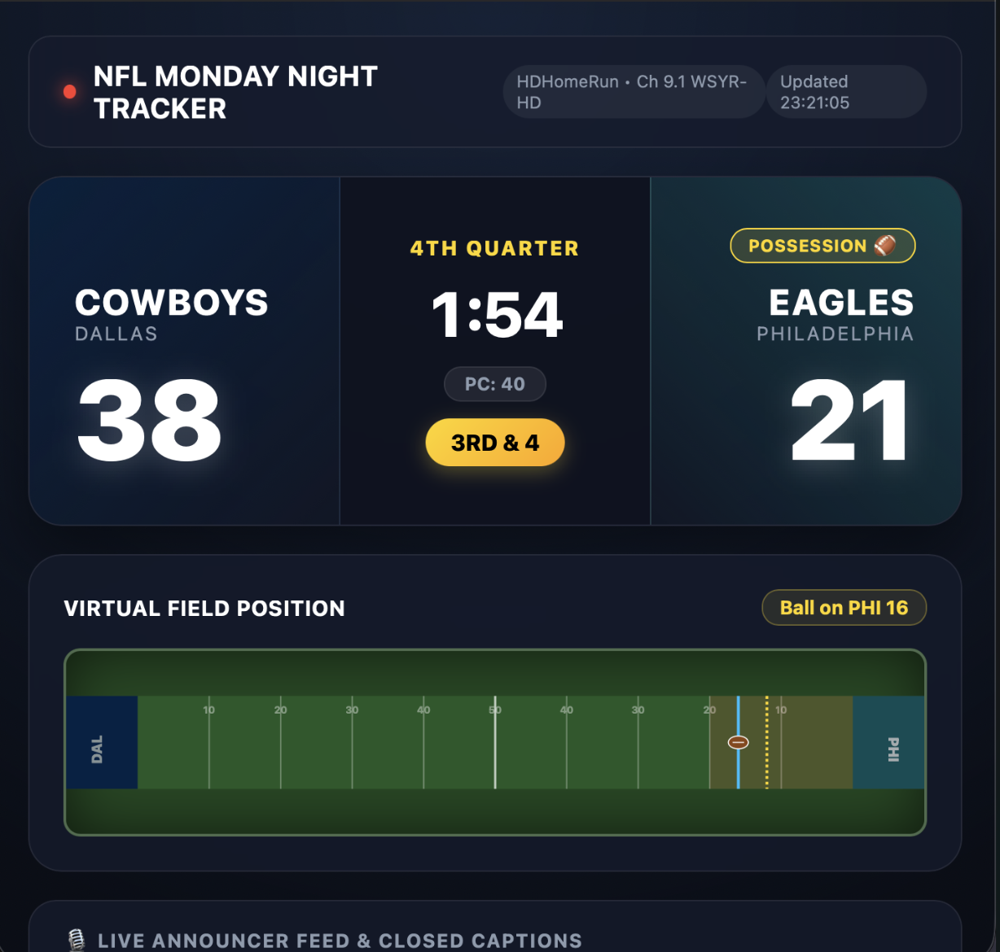
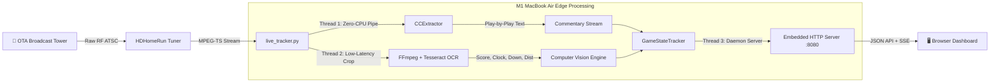
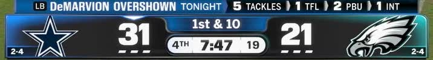

# 🏈 HDHR Live Sports Tracker

> **Edge-computed, zero-latency NFL broadcast telemetry running on Apple Silicon.**  
> Ingests uncompressed Over-The-Air (OTA) television from an HDHomeRun tuner, parses live closed captions in real time, runs optical character recognition (OCR) on the broadcast scorebug, and serves a live interactive web dashboard on `localhost`.

<p align="center">
  
</p>

---

## ⚡ The Architecture

Enterprise sports data APIs (e.g., Sportradar, Genius Sports) cost thousands of dollars per month and streaming television (YouTube TV, Hulu) lags reality by 20–50 seconds. 

By pulling raw RF broadcast waves directly from an **HDHomeRun network tuner**, this project produces a structured real-time JSON game telemetry stream with **sub-second latency** on a fanless M1 MacBook Air at under 5W power draw.



---

## 🎯 Key Capabilities

- **Zero-CPU Closed Caption Extraction**: Pipes MPEG-TS directly to `ccextractor` to ingest live commentary, official referee announcements, and announcer calls without touching the GPU.
- **Scorebug OCR & Segmentation**: Isolates the broadcast scorebug and uses targeted Tesseract OCR with adaptive contrast inversion and border padding:
  
  <p align="center">
    
  </p>

  - Game Clock (`MM:SS`) & Quarter
  - Play Clock (`PC: 40`, `PC: 25`, etc.)
  - Down & Distance (`1st & 10`, `3rd & Goal`, `2nd Down`)
  - Team Scores (with state persistence across broadcast animations)
- **Possession Chevron Luminance Detection**: Measures pixel luminance across team chevron coordinates to determine which team is currently on offense.
- **Break & Commercial Filtering**: Detects when the scorebug is off-screen during commercial breaks or graphic slates to suppress OCR hallucination and emit clean status heartbeats.
- **Embedded Web Dashboard (`http://localhost:8080`)**:
  - Live broadcast scoreboard with glowing possession indicators
  - Interactive SVG 100-yard football field with real-time Line of Scrimmage, 1st Down marker, and Red Zone highlighting
  - Auto-scrolling commentary feed with speaker tags (`Joe Buck`, `Troy Aikman`)
  - Zero external web framework dependencies (built into Python standard library).

---

## 🚀 Quick Start

### 1. Prerequisites (macOS Homebrew)

Install the three lightweight CLI engines:

```bash
brew install ccextractor ffmpeg tesseract
```

*(No third-party Python packages or virtual environments required. Runs on pure Python 3.10+ standard library).*

### 2. Launch the Tracker

Make sure your HDHomeRun tuner is powered on and accessible on your local network:

```bash
# Clone the repository
git clone https://github.com/mikeheneka/hdhr-sports-tracker.git
cd hdhr-sports-tracker

# Run with default HDHomeRun channel
python3 live_tracker.py
```

### 3. Open the Dashboard

Open your browser to:
**[http://localhost:8080](http://localhost:8080)**

---

## ⚙️ CLI Options

```text
usage: live_tracker.py [-h] [--url URL] [--team1 TEAM1] [--team2 TEAM2]
                       [--interval INTERVAL] [--port PORT]

M1 Mac HDHomeRun Live Stream Tracker & Web Dashboard

options:
  -h, --help           show this help message and exit
  --url URL            HDHomeRun channel stream URL (default: http://hdhr-1073ec20.local:5004/auto/v9.1)
  --team1 TEAM1        Team 1 abbreviation/name (default: DAL)
  --team2 TEAM2        Team 2 abbreviation/name (default: PHI)
  --interval INTERVAL  Vision sampling interval in seconds (default: 4)
  --port PORT          Web dashboard port (default: 8080)
```

### Custom Game Example

```bash
# Sunday afternoon broadcast on CBS (Channel 5.1)
python3 live_tracker.py \
  --url http://hdhr-1073ec20.local:5004/auto/v5.1 \
  --team1 BUF \
  --team2 KC \
  --port 8080
```

---

## 📡 REST API

The embedded server exposes a live JSON state endpoint consumed by the web visualizer or custom home automation triggers (e.g., smart home lights flashing on touchdowns):

`GET http://localhost:8080/api/state`

```json
{
  "team1": {
    "name": "DAL",
    "city": "Dallas",
    "mascot": "Cowboys",
    "score": "38",
    "color": "#002244",
    "accent": "#869397",
    "possession": false
  },
  "team2": {
    "name": "PHI",
    "city": "Philadelphia",
    "mascot": "Eagles",
    "score": "21",
    "color": "#004C54",
    "accent": "#A5ACAF",
    "possession": true
  },
  "possession": "PHI",
  "quarter": "4TH",
  "clock": "1:54",
  "play_clock": "40",
  "down_distance": "3RD & 4",
  "field_position": "PHI 16",
  "yardline": 84.0,
  "line_to_gain": 88.0,
  "banner": "204 RUSH YARDS FOR THE COWBOYS",
  "scorebug_visible": true,
  "status": "LIVE"
}
```

---

## 📄 License

MIT License. See [LICENSE](LICENSE) for details.
